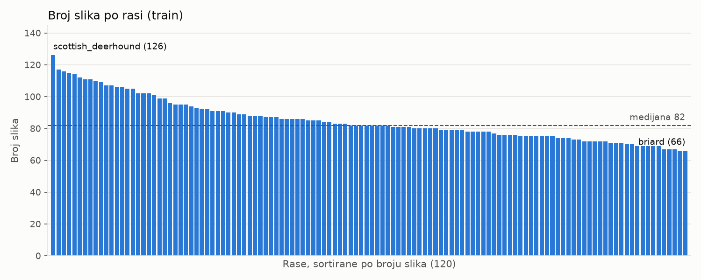
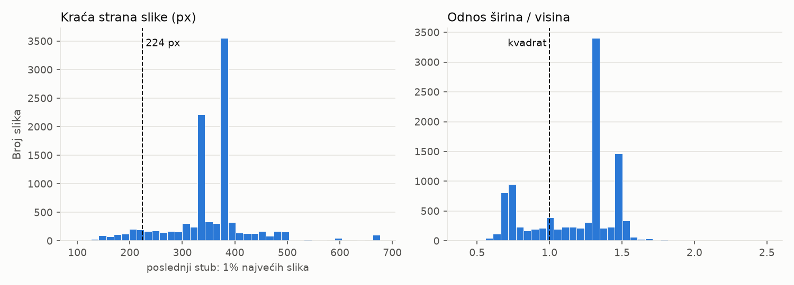

# Faza 1: Podaci

## Cilj

Preuzeti Kaggle skup „Dog Breed Identification“, upoznati ga (rase, veličine slika, greške u oznakama)
i napraviti jednu fiksnu podelu na train, val i test koju koriste sve sledeće faze.

## Koraci (Windows, cmd)

Jednom, pre preuzimanja:
1. Na Kaggle-u prihvatiti pravila takmičenja:
   https://www.kaggle.com/competitions/dog-breed-identification/rules („I Understand and Accept“).
   Bez toga Kaggle ne daje podatke.
2. Povezati Kaggle CLI sa nalogom (otvara browser, kao `gh auth login`).

```bat
cd C:\dev\dog-breed-classifier
.venv\Scripts\activate
python -m pip install -r requirements.txt

kaggle auth login

kaggle competitions download -c dog-breed-identification -p data\raw
tar -xf data\raw\dog-breed-identification.zip -C data\raw

python scripts\analyze_data.py
python scripts\make_splits.py
```

`make_splits.py` ne mora da se pokreće, jer je podela već u repou (`splits/`). Ako se pokrene,
daje potpuno iste fajlove (vidi „Ponovljivost“).

## Odluke

### 1. Podela 70 / 15 / 15 (train / val / test), stratifikovana po rasi

- **Zašto poseban test skup:** Kaggle-ov `test/` nema oznake, pa ne može da služi za merenje tačnosti.
  U fazi 4 Optuna bira hiperparametre prema rezultatu na val skupu, pa taj rezultat postaje previše
  optimističan. Test skup ne gledamo do kraja projekta, da bi konačan broj bio pošten.
- **Zašto stratifikovano:** svaka rasa ima isti udeo u sva tri skupa. Bez toga bi rasa sa 66 slika mogla
  da ostane sa 3–4 slike u val skupu, ili bez ijedne.
- **Kako:** dva poziva `train_test_split` (scikit-learn) sa `stratify`. Prvo 70 / 30, pa tih 30% na pola.
  Seed je 42. Pre podele redovi se sortiraju po `id`, da podela ne zavisi od redosleda ulaza.
- **Cena:** 30% slika ne ide u trening. Kad izaberemo hiperparametre, konačni model može ponovo
  da se istrenira na train + val.
- **Alternative:** 80 / 20 bez testa (više podataka za trening, ali bez poštene konačne procene) i
  k-fold (najpouzdanija procena, ali k puta duži trening, što na laptopu nije praktično).

### 2. Podela se čuva kao CSV u repou

Isti seed ne garantuje istu podelu ako se promeni verzija scikit-learn-a ili redosled fajlova.
`splits/train.csv`, `val.csv` i `test.csv` (kolone `id`, `breed`) zajedno imaju 10.199 redova
i garantuju da svaki eksperiment koristi potpuno isti test skup.

### 3. Duplikati: ista fotografija ide u najviše jedan skup, slike bez jedne tačne oznake se izbacuju

Grupa duplikata = slike sa istim dHash-om (vidi odluku 4).
- **Grupa sa različitim rasama:** izbacuju se sve slike iz grupe. Ili su na slici dva psa, ili je
  bar jedna oznaka pogrešna i iz slike ne može da se odluči koja (vidi „Duplikati“ u rezultatima).
- **Grupa sa istom rasom:** ostaje slika sa najviše piksela, ostale kopije se izbacuju.
- **Zašto:** ista fotografija u train i u test skupu je curenje podataka (data leakage). Model bi bio
  ocenjen na slici koju je već video, pa bi tačnost bila veća nego što stvarno jeste.
- **Alternative:** zadržati obe kopije u istom skupu (nema curenja, ali ista slika ima dvostruku težinu);
  ručno ispraviti oznake (nepouzdano, jer se npr. giant i standard schnauzer razlikuju po veličini, koja
  se sa fotografije ne vidi; a slika sa dva psa i dalje nema jednu oznaku); ništa ne raditi (curenje).
- Spisak izbačenih slika i razlog za svaku je u `splits/excluded.csv`.

### 4. dHash pored SHA-256

SHA-256 hvata samo fajlove koji su isti bajt po bajt. Ista fotografija sačuvana sa drugačijom kompresijom
ili u drugoj veličini ima drugačiji SHA-256. dHash (`scripts/image_hash.py`) smanji sliku na 9×8 piksela
u sivom i za svaki piksel zabeleži da li je svetliji od desnog suseda. To je 64 bita koja opisuju
„oblik“ slike, a ne njene bajtove. Ovde je dHash našao 2 grupe koje SHA-256 nije video (vidi rezultate).

Grupišemo samo po potpuno istom dHash-u. Slike koje se razlikuju u nekoliko bitova (isečak, drugi kadar
istog trenutka) ovde se ne hvataju. Svih 17 grupa koje su nađene pregledane su ručno.

### 5. Kaggle CLI: prijava preko `kaggle auth login`

Kaggle CLI 2.2.5 nudi prijavu preko browsera (OAuth), tokena u promenljivoj okruženja ili fajla sa tokenom.
Izabrana je prijava preko browsera: token se ne kopira ručno, pa ne može slučajno da završi u repou
ili u istoriji terminala.

`kaggle==2.2.5` koristi paket `six`, ali ga ne navodi u svojim zavisnostima, pa se CLI bez njega ne pokreće
(`ModuleNotFoundError: No module named 'six'`). Zato je `six==1.17.0` dodat u `requirements.txt`.

### 6. Tačne verzije u `requirements.txt`

Kao i za PyTorch: `kaggle==2.2.5`, `six==1.17.0`, `pandas==3.1.1`, `scikit-learn==1.9.1`, `matplotlib==3.11.2`.
Navedene su samo direktne zavisnosti. Njihove zavisnosti pip bira sam.

### 7. Bez balansiranja klasa, za sada

Najveća rasa ima 1.91× više slika od najmanje (vidi rezultate). Razlika je mala, a stratifikacija čuva
iste udele u svim skupovima. Težinski gubitak (weighted loss) ili češće uzorkovanje malih rasa
(oversampling) razmatramo tek ako se u fazi 5 pokaže da model greši baš na malim rasama.

### 8. Slike iz skupa ne idu u repo

Licenca dozvoljava korišćenje podataka za nekomercijalno istraživanje, ali ne i ponovno objavljivanje
slika. U repou su samo oznake (`splits/`) i grafikoni sa brojevima (`docs/img/`).

## Rezultati

Izmereno 8. 11. 2026.

### Preuzimanje

| | |
|---|---|
| Arhiva | `dog-breed-identification.zip`, 724.495.926 B (691 MiB), preuzeta za ~2,5 min |
| Provera arhive | CRC svih fajlova ispravan, nijedna putanja ne izlazi van ciljnog foldera |
| Sadržaj | `train/` 10.222 slike, `test/` 10.357 slika (bez oznaka), `labels.csv`, `sample_submission.csv` |
| Raspakovano | 716 MiB |

### Oznake i fajlovi

`labels.csv` ima 10.222 reda sa 10.222 različita `id`-ja. Za svaku oznaku postoji fajl u `train/`
i za svaki fajl postoji oznaka.

### Rase



| | |
|---|---|
| Broj rasa | 120 |
| Slika po rasi | najmanje 66, medijana 82, prosek 85,2, najviše 126 |
| Najviše / najmanje | 1,91× |
| Najmanje slika | eskimo_dog (66), briard (66), golden_retriever (67), komondor (67), brabancon_griffon (67) |
| Najviše slika | scottish_deerhound (126), maltese_dog (117), afghan_hound (116), entlebucher (115), bernese_mountain_dog (114) |

### Slike



| | |
|---|---|
| Oštećene ili nečitljive | 0 (svaka slika je dekodirana do kraja) |
| Format | svih 10.222 su JPEG |
| Mod boja | svih 10.222 su RGB (nema crno-belih ni CMYK) |
| EXIF orijentacija različita od 1 | 0 (nijednu sliku ne treba rotirati) |
| Na disku | 345 MiB, medijana 31 KiB po slici |

Percentili (5 / 25 / 50 / 75 / 95):

| | 5% | 25% | 50% | 75% | 95% | min | max |
|---|---|---|---|---|---|---|---|
| Širina (px) | 222 | 360 | 500 | 500 | 500 | 97 | 3264 |
| Visina (px) | 211 | 333 | 375 | 452 | 500 | 102 | 2562 |
| Kraća strana (px) | 200 | 332 | 373 | 375 | 480 | 97 | 2448 |
| Širina / visina | 0,67 | 0,93 | 1,33 | 1,34 | 1,51 | | |

- Kraća strana je manja od 224 px kod 784 slike (7,7%). Te slike će se za ulaz od 224×224 uvećavati,
  a sve ostale smanjivati.
- 70,2% slika je položeno, 27,9% uspravno, a 1,9% kvadratno. Najčešći odnos je 4:3 (1,33).

### Duplikati

| | Grupa | Slika |
|---|---|---|
| Potpuno isti fajlovi (SHA-256) | 15 | 30 |
| Ista slika po dHash-u (uključuje i gornje) | 17 | 34 |

Dve grupe koje je našao samo dHash su ista fotografija sačuvana drugačije (provereno pregledom):
- english_setter: ista slika u dve veličine (300×261 i 250×223 px);
- japanese_spaniel: ista slika iste veličine (385×391 px), ali druge kompresije (17.442 i 19.037 B).

Šest grupa ima istu sliku pod dve različite rase:

| Rase | Šta je na slici |
|---|---|
| whippet / briard | dva psa: briard i whippet |
| miniature_poodle / toy_poodle | dve pudle |
| lakeland_terrier / wire-haired_fox_terrier | jedan pas |
| japanese_spaniel / blenheim_spaniel | jedan pas |
| papillon / japanese_spaniel | jedan pas |
| giant_schnauzer / standard_schnauzer | jedan pas |

Izbačeno je 23 od 10.222 slike (0,2%): 12 iz grupa sa različitim rasama i 11 viška kopija iz grupa
sa istom rasom. Ostaje 10.199 slika.

### Podela

| Skup | Slika | Udeo | Rasa | Slika po rasi (min / medijana / max) |
|---|---|---|---|---|
| train | 7.139 | 70,0% | 120 | 46 / 57 / 87 |
| val | 1.530 | 15,0% | 120 | 9 / 12 / 19 |
| test | 1.530 | 15,0% | 120 | 10 / 12 / 18 |

Skripta pre upisa proverava da nijedan `id` i nijedan dHash nisu u dva skupa i da svaki skup ima
svih 120 rasa. Ako provera ne prođe, prekida rad.

**Ponovljivost:** posle drugog pokretanja `make_splits.py` SHA-256 sve četiri datoteke u `splits/`
su identične prvom. Git na Windows-u (`core.autocrlf=true`) bi pri checkout-u promenio krajeve
redova u CRLF i fajlovi više ne bi bili isti bajt po bajt. Zato `.gitattributes` za `splits/*.csv`
propisuje LF. Provereno: posle brisanja i ponovnog checkout-a SHA-256 su isti kao posle pokretanja skripte.

Vreme na laptopu: `analyze_data.py` 69 s (dekodira svih 10.222 slike), `make_splits.py` 18 s.

**Zaključak:**
- Podaci su čisti: nema oštećenih slika, sve su RGB JPEG, ništa ne treba rotirati, a oznake i fajlovi
  se poklapaju. Jedini problem su duplikati, i on je rešen.
- Rase su skoro ujednačene (1,91×), pa za sada ne balansiramo klase.
- Tipična slika je 500×375. Za ulaz od 224×224 većina slika se smanjuje, a samo 7,7% se uvećava.
- Najčešći odnos stranica je 4:3. Isecanje kvadrata iz sredine odseca deo slike sa strane, pa pas
  može delimično da ostane van kadra. To uzimamo u obzir pri izboru transformacija u fazama 2 i 3.

## Ograničenja

- **ImageNet:** ovaj skup je izveden iz Stanford Dogs, a on iz ImageNet-a. Modeli prethodno trenirani
  na ImageNet-u (koristimo ih od faze 2) verovatno su već videli deo ovih slika. Tačnost na našem test
  skupu zato može biti nešto bolja nego na potpuno novim fotografijama. Bez drugog izvora slika ovo
  ne može potpuno da se izbegne.
- **Mali val i test po rasi:** 9–19 slika po rasi. Ukupna tačnost na 1.530 slika je dovoljno stabilna,
  ali tačnost za pojedinačnu rasu je gruba procena (jedna slika više ili manje pomera je za 5–11 procentnih poena).
- **Duplikati:** hvatamo samo potpuno isti dHash. Slični, ali ne isti snimci (isečak, isti pas u sekundi
  razmaka) mogu da ostanu u različitim skupovima.
- **Oznake:** greške u oznakama koje nisu vezane za duplikate ovde ne vidimo. Na njih ćemo možda naići
  u analizi grešaka (faza 5).

## Pitanja za proveru razumevanja

1. Zašto pravimo i test skup kada već imamo val? Šta se dešava sa tačnošću na val skupu posle faze 4?
2. Šta znači stratifikovana podela i šta bi moglo da se desi rasi sa 66 slika bez nje?
3. Zašto podelu čuvamo kao CSV, a ne samo kao seed?
4. Zašto SHA-256 nije dovoljan za pronalaženje duplikata i kako radi dHash?
5. Šta je curenje podataka (data leakage) i kako bi duplikat u train i test skupu uticao na rezultat?
6. Zašto sliku sa dve različite oznake izbacujemo, umesto da zadržimo obe?
7. Najveća rasa ima 1,91× više slika od najmanje. Da li je potrebno balansiranje i kada bi bilo?
8. Šta za procenu tačnosti znači to što je skup izveden iz ImageNet-a?

## Sledeći korak

Faza 2: polazni model. Fine-tuning prethodno treniranog modela (< 30M parametara) i merenje top-1 i top-3
tačnosti na val skupu.
