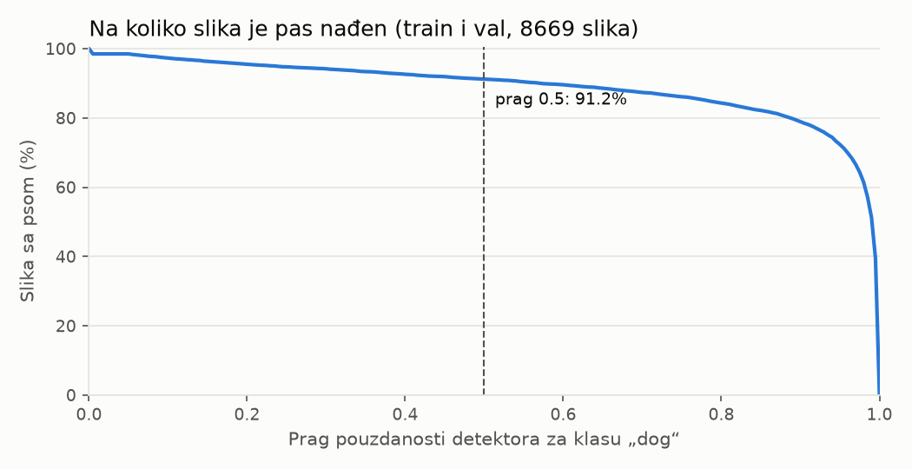
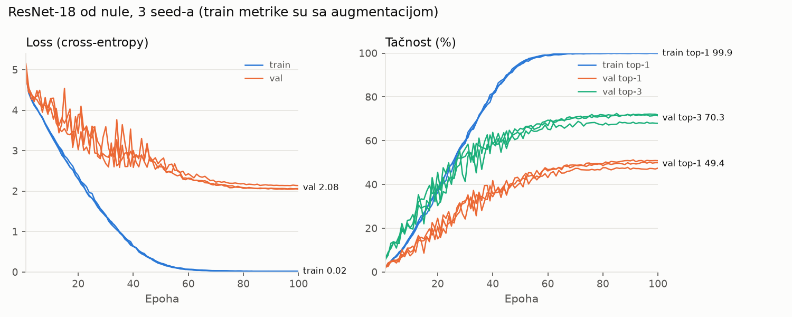

# Faza 2: Polazni model

## Cilj

Napraviti polazni sistem od dva koraka i izmeriti prvi broj: top-1 i top-3 tačnost celog lanca
(detektor, pa klasifikator) na val skupu. Test skup ne gledamo.

```
fotografija ─► detektor pasa ─► okvir psa ─► kvadrat iz originala ─► 224×224 ─► klasifikator ─► 3 rase
               Faster R-CNN                  (dopuna ili blago                     ResNet-18
               MobileNetV3, COCO              odsecanje)                           od nule
               19,4M parametara                                                    11,2M parametara
```

## Koraci (Windows, cmd)

```bat
cd C:\dev\dog-breed-classifier
.venv\Scripts\activate

rem 1. Detektor na svih 10.199 slika (jednom, ~5 min). Težine (~74 MB) se preuzimaju pri prvom pokretanju.
python scripts\detect_dogs.py
rem 2. Brojevi o detekcijama (samo train i val) i grafikon praga
python scripts\analyze_detections.py
rem 3. Keš: isečci 224x224 za train, val i test (~25 s)
python scripts\build_cache.py
rem 4. Kontakt listovi za vizuelnu proveru (u data\previews, ne idu u git)
python scripts\preview_crops.py

rem 5. Trening od nule, 3 seed-a (~12 min svaki), laptop na punjaču
python scripts\train.py --seed 42
python scripts\train.py --seed 43
python scripts\train.py --seed 44
python scripts\plot_training.py

rem 6. Koliko gotov ImageNet model već zna naše rase (težine ~45 MB, samo za ovo merenje)
python scripts\imagenet_baseline.py
```

| Skripta | Šta radi |
|---|---|
| `preprocess.py` | pravila pripreme slike: izbor okvira, kvadrat, dopuna, smanjenje. Isti kod koriste keš i kasnije API |
| `detect_dogs.py` | pokreće detektor i čuva **sve** detekcije iznad 0,05 u `data/detections.csv` |
| `analyze_detections.py` | prag, šta detektor vidi kad psa ne nađe, dopuna i odsecanje |
| `build_cache.py` | `data/cache/{skup}.npy` (uint8, N×224×224×3), `{skup}.csv` i `info.json` |
| `preview_crops.py` | kontakt listovi: original sa okvirima pored ulaza klasifikatora |
| `train.py` | trening ResNet-18 od nule, log po epohi, checkpoint sa podešavanjima pripreme |
| `plot_training.py` | krive učenja i rezime za više seed-ova |
| `imagenet_baseline.py` | gotov ImageNet ResNet-18 na našem val skupu, bez treninga (samo za poređenje) |

Detekcije se čuvaju odvojeno od isecanja. Prag i pravila isecanja mogu da se menjaju bez ponovnog
pokretanja detektora: posle izmene u `preprocess.py` dovoljno je ponovo pokrenuti korake 2–4.

## Odluke

### 1. Klasifikator treniramo od nule, a ne doučavamo ImageNet model

`docs/01-podaci.md` je planirao doučavanje (fine-tuning) prethodno treniranog modela do 30M parametara.
Plan je promenjen pre početka faze:
- **Zašto:** ImageNet-1k ima svih 120 naših rasa kao klase, a naš skup je izveden iz Stanford Dogs, koji
  je izveden iz ImageNet-a. Model sa ImageNet težinama je verovatno već video naše val i test slike
  sa tačnom rasom. Tačnost na našem test skupu bi bila curenje podataka, a ne procena za nove fotografije.
  Koliko gotov ImageNet model već zna naše rase, bez ikakvog treninga, izmereno je u „Rezultatima“.
- **Cena:** od nule, na ~7.000 slika, tačnost će biti znatno niža nego uz ImageNet težine.
  Zato je ovo tek polazni broj, a fazama 3 i 4 ga popravljamo.
- **Alternative:** doučavanje uz napomenu o curenju (lep broj, ali ne znamo koliko je pošten);
  prethodni trening na skupu bez pasa (npr. ImageNet bez 120 rasa, previše posla i računanja za laptop).

### 2. Ceo sistem do 50M parametara, klasifikator ResNet-18

Granica od 30M iz faze 1 promenjena je u 50M za ceo sistem (detektor + klasifikator).

Brzina treninga na 224 px, BF16, sa nasumičnim podacima (merenje pre faze, na punjaču):

| Model | Parametri | + detektor | Batch | Slika/s | Epoha (7.139 slika) | VRAM vrh |
|---|---|---|---|---|---|---|
| ResNet-18 | 11,2M | 30,6M | 128 | 1.130 | 6,3 s | 1,84 GiB |
| ResNet-34 | 21,3M | 40,7M | 128 | 669 | 10,7 s | 2,41 GiB |
| ResNet-50 | 23,8M | 43,2M | 64 | 397 | 18,0 s | 3,00 GiB |
| ResNet-50 | 23,8M | 43,2M | 128 | 127 | 56,0 s | 5,65 GiB |

- **Izbor: ResNet-18.** Trening se ponavlja ~3× brže nego sa ResNet-50, a u fazama 2 i 3 ćemo ga pokretati
  mnogo puta. Kad treniramo od nule na malo slika, veći model ne znači automatski bolji rezultat.
  Arhitektura postaje hiperparametar u fazi 4.
- **ResNet-50 sa batch-om 128 ne staje u ~5 GiB slobodnog VRAM-a, a program ipak ne pada.** Windows
  drajver (WDDM) višak tiho prebacuje u sistemsku memoriju i trening postaje ~3× sporiji. Zato `train.py`
  beleži vrh zauzeća VRAM-a u `summary.json`.
- Broj parametara: `resnet18(num_classes=120)` ima 11.238.072, detektor 19.386.354, ukupno **30.624.426**.

### 3. Gotov COCO detektor kao poseban korak: Faster R-CNN MobileNetV3-Large FPN

Klasifikator dobija isečenog psa umesto cele fotografije, pa pas dobija više piksela, a pozadina manje.
Detektor se ne doučava. On zna samo klasu „dog“, ne i rase. Za klasifikator je samo prvi korak.

| Detektor (torchvision, COCO) | Parametri | COCO box mAP | GFLOPS (torchvision) |
|---|---|---|---|
| SSDlite320 MobileNetV3 | 3,4M | 21,3 | 0,58 |
| Faster R-CNN MobileNetV3-Large 320 FPN | 19,4M | 22,8 | 0,72 |
| **Faster R-CNN MobileNetV3-Large FPN** | **19,4M** | **32,8** | **4,49** |
| RetinaNet ResNet-50 FPN | 34,0M | 36,4 | 151,5 |

- **Zašto ovaj:** najbolji odnos tačnosti i veličine koji staje u budžet. Varijanta 320 je ~4,4× brža
  sa batch-om 8 (izmereno pre faze, sa nasumičnim težinama), ali ima 10 poena manji mAP. Brzina nam ovde
  nije presudna: detektor u treningu radi jednom, a u produkciji obrađuje jednu sliku.
- **Detektor uvećava sliku:** kraća strana ide na 800 px (duža najviše 1.333). Slika 500×375 postaje
  1.067×800, pa detektor radi na ~4,5× više piksela od originala. Zato je mnogo sporiji od klasifikatora.
- **Čuvamo sve detekcije iznad 0,05** (90.168 redova za 10.199 slika), ne samo izabrani okvir. Tako vidimo
  šta detektor vidi kad psa ne nađe, a pravila možemo da menjamo bez ponovnog pokretanja.
- **Alternativa:** ručni okviri iz originalnog Stanford Dogs skupa. Postoje za sve slike, ali ih u
  produkciji nema, pa bi detektor i dalje bio potreban. A klasifikator treba da uči na okvirima
  kakve će dobijati u produkciji.
- Odluka bez A/B poređenja sa varijantom bez detektora (odluka autora). Koliko detektor doprinosi tačnosti
  zato ne merimo.

### 4. Izbor okvira: pas iznad 0,5, najsigurniji pas, a kad psa nema, druga životinja

1. Najsigurniji okvir klase „dog“ sa pouzdanošću ≥ 0,5. Kad ima više pasa, uzima se najsigurniji
   (odluka autora). Okvir oko svih pasa bi imao malo piksela po psu, a često i dve rase.
2. **Ako psa nema:** najsigurniji okvir druge životinje ≥ 0,5 (mačka, ovca, medved, konj, krava, ptica,
   slon, zebra, žirafa i plišani meda; čovek nije na spisku).
3. Inače nema okvira (vidi odluku 6).

Pravilo 2 je dodato posle analize, a pre treninga. Prvobitno pravilo je bilo „nema psa, izbaci sliku
iz train skupa“. Analiza je pokazala da COCO detektor neke rase redovno vidi kao drugu životinju:
čupave kao ovcu ili medveda, krupne kao kravu ili konja, a male kao mačku. Izbacivanje ne bi pogodilo
sve rase podjednako. Komondor bi izgubio 65% slika za trening, a irski vodeni španijel 38%. Model bi
te rase skoro ređe viđao u treningu, a u val i test skupu bi ostale. Brojevi su u „Rezultatima“.

- **Provera pregledom:** u dva nasumična uzorka (18 i 24 slike) okvir „druge životinje“ je u 40 od 42
  slučaja ceo pas. Jednom je okvir samo glava pekinezera, a jednom prava mačka na slici vestija.
- **Zašto ovo sme:** na svakoj slici u našem skupu je pas. U produkciji to ne važi (vidi „Ograničenja“).
- **Alternative:** niži prag za psa (0,3 daje 94% umesto 91% slika, ali sa slabijim okvirima, a komondor
  bi i dalje gubio 56% slika); okvir oko svih životinja; izbacivanje (prvobitno pravilo).

### 5. Kvadrat oko psa: margina 10%, blago odsecanje do 20%, inače dopuna srednjom bojom

- **Stranica kvadrata** je duža stranica okvira plus 10%, jer su okviri tesni pa ispadaju uši i rep.
  Kvadrat je centriran na okvir i pomera se ka unutra kad izlazi iz slike.
- **Margina nikad sama ne izaziva dopunu:** ako okvir staje u kraću stranu slike, margina se smanji.
- **Blago odsecanje:** ako je okvir duži od kraće strane slike za najviše 20% svoje duže stranice, kvadrat
  je kraća strana slike. Odsecaju se krajevi psa (rep, šape, leđa), podjednako sa obe strane.
- **Inače dopuna:** kvadrat obuhvata celog psa, a deo van slike se popunjava srednjom bojom train skupa,
  RGB (122, 115, 100).
- **Zašto je odsecanje dodato:** sa prvobitnim pravilom (uvek dopuna) 37,7% isečaka je imalo dopunu,
  a u medijani je dopuna zauzimala 21% kvadrata. Pas koji leži preko cele položene slike ima okvir duži
  od visine slike, pa je to čest slučaj, a ne izuzetak. Dopuna troši piksele koje bi pas mogao da dobije.
  Pregled 24 isečka sa najviše odsecanja (svih 20%) pokazuje da je glava svuda sačuvana. Augmentacija u
  treningu ionako seče do pola površine, pa je blago odsecanje u skladu sa onim što model već viđa.
- **Zašto 20%:** izabrano pregledom slika, ne merenjem. Do ~20% gubi se kraj repa, šapa ili leđa,
  a kod većih odsecanja (npr. 37% kod jednog stafordšira) počinje da ispada donji deo tela. Dopunu i odsecanje možemo da uporedimo merenjem u fazi 3.
- **Zašto srednja boja:** posle normalizacije postaje ~0, kao dopuna nulama unutar mreže, pa ne unosi
  nove ivice. Šum bi svaka slika dobila drugačiji, a produkcija bi zavisila od nasumičnosti. Boja se
  računa samo iz train skupa i čuva u checkpoint-u, da API koristi istu.
- **Isecanje iz originala:** pas se iseca iz slike u punoj rezoluciji, pa se tek onda smanjuje na
  224 px (LANCZOS, koji radi antialiasing pri smanjenju).

### 6. Slike bez okvira: iz train skupa se izbacuju, val i test idu na rezervnu varijantu

- **Train:** slika se izbacuje (odluka autora). Posle pravila 2 to je 59 slika (0,8%).
- **Val, test i produkcija:** slika se ne izbacuje. U produkciji ne možemo da odbijemo korisnikovu sliku,
  a izbacivanje teških slika iz val skupa bi ulepšalo tačnost. Rezervna varijanta: centralni kvadrat ako
  ostaje bar 60% duže strane slike, a inače cela slika dopunjena do kvadrata.

### 7. Keš u RAM-u GPU-a

Svaka slika se dekodira i iseca jednom (`build_cache.py`), i rezultat se čuva kao uint8 niz.
Train (0,99 GiB) i val (0,21 GiB) ceo trening stoje na GPU-u, pa nema čitanja sa diska ni dekodiranja
JPEG-a tokom treninga. Augmentacija radi na GPU-u.
- **Cena:** keš mora ponovo da se napravi kad se promene pravila pripreme (~22 s).
- **Alternativa:** `DataLoader` sa dekodiranjem u svakoj epohi. Fleksibilnije, ali procesor bi bio
  usko grlo za mrežu ove veličine.

### 8. Polazni recept za trening (namerno jednostavan)

- `resnet18(weights=None)`, 120 izlaza, ulaz 224 px, batch 128.
- SGD, moment 0,9, weight decay 5e-4, stopa učenja 0,1 koja kosinusno opada do 0 (posle svakog koraka),
  100 epoha.
- **BF16 i channels_last od početka.** README je BF16 stavljao u fazu 3, ali ga koristimo već ovde,
  jer je brže, a BF16 ne traži GradScaler (ima isti opseg eksponenta kao FP32). U fazi 3 ostaje
  poređenje sa FP32.
- **Augmentacija na GPU-u, posebno za svaku sliku:** nasumičan isečak od 50–100% površine, odnos
  stranica 3/4–4/3, i ogledanje levo-desno. Torchvision-ove transformacije na celom batch-u primenjuju
  isti isečak na sve slike, pa je ovo napisano ručno (`affine_grid` i `grid_sample`). Val ide bez augmentacije.
- **Normalizacija:** srednja vrednost i std po kanalu iz train keša.
- Ovo su razumne polazne vrednosti, ne podešene. Jače augmentacije i raspored stope učenja su posao
  faze 3, a pretraga hiperparametara faze 4.

### 9. Tri seed-a i model posle poslednje epohe

- Trening se ponavlja sa seed-ovima 42, 43 i 44. Razlika između njih pokazuje koliko se rezultat menja
  samo od nasumičnosti (početne težine, redosled, augmentacija). Bez tog broja u fazi 3 ne bismo znali
  da li je poboljšanje od jednog poena stvarno.
- **Prijavljujemo model posle poslednje epohe, a ne najbolju epohu na val skupu.** Izbor najbolje epohe
  po val skupu bi taj broj učinio previše optimističnim. Val ovde služi samo za praćenje.
- `cudnn.benchmark` bira najbrži algoritam za konvolucije, pa dva pokretanja sa istim seed-om nisu
  identična do poslednjeg bita, ali su statistički ista.

## Rezultati

Izmereno 8. i 9. 11. 2026, laptop na punjaču.

### Preuzete težine

| Fajl | Veličina | Za šta |
|---|---|---|
| `fasterrcnn_mobilenet_v3_large_fpn-fb6a3cc7.pth` | 74,2 MB | detektor |
| `resnet18-f37072fd.pth` | 44,7 MB | samo merenje ImageNet glave |

Oba su sa download.pytorch.org, u kešu PyTorch-a (van repoa). Učitana su sa `weights_only=True`
(pickle ne može da izvrši kod), a početak SHA-256 se poklapa sa oznakom u imenu fajla.

### Detektor

| | |
|---|---|
| Slika | 10.199 (train, val i test) |
| Vreme | 292 s, **35,0 slika/s** (batch 8, 4 procesa za učitavanje) |
| Detekcija iznad 0,05 | 90.168 |

Jednom je PyTorch upozorio da alokacija od 924.844.032 B (0,86 GiB) nije uspela jer je VRAM pun.
PyTorch tada oslobađa svoju keširanu memoriju i pokušava ponovo, i rad je nastavljen do kraja
(detekcije postoje za svih 10.199 slika). Verovatan uzrok: slike u batch-u se dopunjuju do najveće među
njima, pa batch sa položenom (1.067×800) i uspravnom (800×1.067) slikom postaje ~1.088×1.088 po slici.
U produkciji (jedna slika) ovo je nevažno. Za veći batch bi trebalo grupisati slike po orijentaciji.

### Okviri (train i val, 8.669 slika)



| Pas iznad praga | 0,1 | 0,3 | **0,5** | 0,7 | 0,9 |
|---|---|---|---|---|---|
| train (7.139) | 97,4% | 94,3% | **91,2%** | 87,4% | 78,7% |
| val (1.530) | 97,1% | 93,8% | **91,0%** | 87,2% | 79,8% |

**Bez psa iznad 0,5: 764 slike (8,8%).** Najsigurnija detekcija na tim slikama: mačka 148, ovca 139,
medved 117, čovek 115, konj 75, plišani meda 50, ptica 38, krava 29, ostalo ≤ 8.

Posle pravila „druga životinja“ (odluka 4) okvir druge životinje dobija 694 slike (mačka 167, ovca 166,
medved 116, konj 95, plišani meda 58, ptica 37, krava 37, žirafa 9, slon 9).

| | Ima okvir | Bez okvira |
|---|---|---|
| train | 99,2% | 59 |
| val | 99,3% | 11 |

Rase sa najviše slika bez psa (train + val):

| Rasa | Slika | Bez psa iznad 0,5 | Bez ikakvog okvira |
|---|---|---|---|
| komondor | 57 | 64,9% | 12,3% |
| irish_water_spaniel | 66 | 37,9% | 6,1% |
| curly-coated_retriever | 61 | 32,8% | 0,0% |
| dhole | 65 | 30,8% | 6,2% |
| affenpinscher | 68 | 29,4% | 1,5% |
| bouvier_des_flandres | 73 | 26,0% | 6,8% |
| mexican_hairless | 67 | 25,4% | 4,5% |
| african_hunting_dog | 73 | 24,7% | 4,1% |

**Broj pasa iznad 0,5 po slici:** 0: 764, 1: 6.988, 2: 743, 3: 139, 4: 28, 5: 6, 6: 1.
Dva ili više pasa ima 917 slika (10,6%).

**Isečci** (8.599 slika sa okvirom):

| | |
|---|---|
| Dopuna srednjom bojom | 915 (10,6%); sa prvobitnim pravilom 37,7% |
| Blago odsecanje | 2.372 (27,6%); odsečeno 5,2% / 9,9% / 14,7% duže stranice okvira (percentili 25 / 50 / 75) |
| Udeo okvira u površini slike | 12% / 33% / 53% / 72% / 89% (percentili 5 / 25 / 50 / 75 / 95) |
| Stranica kvadrata u originalu | 165 / 264 / 333 / 375 / 500 px (isti percentili) |
| Kvadrat manji od 224 px (uvećava se) | 1.349 (15,7%) |

Pas u medijani zauzima polovinu slike, pa isecanje oko okvira kod tipične slike daje skromno uvećanje.
Kod 5% slika pas zauzima ≤ 12% slike, i tu je dobit najveća.

### Keš

| Skup | Slika | Izbačeno | Rezervna varijanta | Okvir druge životinje | Dopuna | Odsecanje | Veličina |
|---|---|---|---|---|---|---|---|
| train | 7.080 | 59 | 0 | 568 | 757 | 1.957 | 0,99 GiB |
| val | 1.530 | 0 | 11 | 126 | 158 | 415 | 0,21 GiB |

Test keš je napravljen istim pravilima, ali ga ne analiziramo. Ceo keš (srednja boja, pa sva tri skupa)
pravi se za 22 s.

### Trening

ResNet-18 od nule, 100 epoha, 7.080 slika za trening, ocena na 1.530 val slika
(RTX 3060 Laptop, PyTorch 2.14.1+cu132, torchvision 0.29.1).



| Seed | Val top-1 | Val top-3 | Val loss | Najbolja epoha po val top-1 | Trajanje | Slika/s (trening) |
|---|---|---|---|---|---|---|
| 42 | 50,85% | 71,37% | 2,049 | 91. (51,24%) | 12,4 min | 1.015 |
| 43 | 49,93% | 71,76% | 2,063 | 97. (50,20%) | 12,5 min | 1.009 |
| 44 | 47,45% | 67,91% | 2,137 | 89. (47,78%) | 13,0 min | 970 |
| **Prosek ± std** | **49,41% ± 1,76** | **70,35% ± 2,12** | 2,083 ± 0,047 | | | |

Prijavljeni broj je model posle poslednje epohe (odluka 9). Std je uzoračka standardna devijacija
preko 3 seed-a.

| | |
|---|---|
| Parametri klasifikatora | 11.238.072 (checkpoint 45,0 MB, FP32) |
| Ceo sistem | 30.624.426 parametara |
| Epoha | ~6,9–7,3 s trening + ~0,5 s val; prva epoha ~14 s (`cudnn.benchmark` bira algoritme) |
| VRAM vrh | 3,74 GiB zauzeto, 4,79 GiB rezervisano (od ~5 GiB slobodnih), brzina stabilna, bez prelivanja u RAM |
| Train top-1 posle poslednje epohe | 99,9% u sva tri seed-a (sa augmentacijom), train loss 0,02 |

**Šta pokazuju krive:**
- **Model pamti train skup.** Od ~60. epohe train loss je skoro 0, a train top-1 99,9% čak i sa
  augmentacijom. Val top-1 je u isto vreme ~45%. Razlika od 50 poena je glavni problem za fazu 3:
  jače augmentacije i regularizacija.
- **Val loss ne raste ni kad se model prenauči**, nego polako opada do kraja, uz stopu učenja koja
  opada. Posle ~75. epohe (stopa < 0,016) val tačnost se skoro ne menja.
- **Najbolja epoha je za 0,3–0,4 poena bolja od poslednje.** To je u granicama šuma, pa pravilo
  „poslednja epoha“ skoro ništa ne košta, a broj ostaje pošten.
- **Rasipanje između seed-ova je veliko:** 3,4 poena između najboljeg i najgoreg (52 slike), std 1,76.
  U fazi 3 poboljšanje od 1–2 poena sa jednim seed-om ne znači ništa. Treba porediti proseke više seed-ova.
- Brzina u treningu (~1.000 slika/s) je ~10% manja od merenja pre faze (1.130 slika/s), zbog augmentacije
  i pripreme batch-a.

Val tačnost po vrsti isečka, prosek preko 3 seed-a:

| Isečak | Val slika | Top-1 | Top-3 |
|---|---|---|---|
| pas, ceo u kvadratu | 871 | 48,8% | 69,3% |
| pas, blago odsecanje | 375 | 50,9% | 72,4% |
| pas, dopuna | 147 | 47,4% | 68,5% |
| okvir druge životinje | 126 | 51,1% | 73,3% |
| rezervna varijanta (bez okvira) | 11 | 57,6% | 75,8% |

Nijedna grupa nije primetno lošija od proseka. Grupe su male (kod 147 slika jedna standardna greška je
~4 poena) i razlikuju se i po rasama, pa ovo nije poređenje pravila, nego samo provera da novo
pravilo ili odsecanje ne pravi očigledno lošu grupu.

### Koliko ImageNet već zna naše rase

Gotov `resnet18` sa ImageNet težinama (`IMAGENET1K_V1`) i originalnom glavom od 1.000 klasa, **bez ikakvog
treninga na našem skupu**, na istim val isečcima i sa ImageNet normalizacijom (`imagenet_baseline.py`).
Naše rase su upisane na ImageNet klase po imenu, samo u bloku pasa (klase 151–275), jer „cardigan“ postoji
i kao džemper (klasa 474).

| | Top-1 | Top-3 |
|---|---|---|
| ImageNet ResNet-18, izbor samo između naših 120 rasa | **83,27%** | **95,75%** |
| ImageNet ResNet-18, izbor između svih 1.000 klasa | 83,01% | 95,42% |
| Naš ResNet-18 od nule (prosek 3 seed-a) | 49,41% | 70,35% |

- Ista arhitektura i isti ulazi, a razlika je 34 poena top-1. Kad bismo doučavali ImageNet model,
  polazili bismo od ~83% i ne bismo znali koliko od toga je pošteno.
- **Ovo nije samo curenje.** ImageNet ima ~1.300 slika po rasi za trening, a mi ~59, pa bi i model koji
  naše slike nikad nije video verovatno bio znatno bolji od našeg. Iz ovog broja ne možemo da razdvojimo
  koliko je pravo znanje, a koliko pamćenje naših val slika. Upravo zato ga ne koristimo kao rezultat.
- Između 120 i 1.000 klasa skoro nema razlike: kad greši, ImageNet model skoro uvek bira drugu rasu
  psa, a ne neki predmet.

**Zaključak:**
- Polazni sistem (detektor + ResNet-18 od nule, 30,6M parametara) ima **49,4% top-1 i 70,4% top-3** na
  val skupu, uz rasipanje između seed-ova od ±1,8 poena (top-1).
- Model pamti train skup (99,9% train top-1), pa najveći prostor za napredak nisu veći modeli, nego
  regularizacija i jače augmentacije (faza 3).
- Detektor nalazi okvir na 99,2% slika. Pravila „druga životinja“ i „blago odsecanje“ nisu napravila
  grupu slika koja je primetno lošija.
- Ceo trening traje ~12,5 min po seed-u i staje u VRAM sa ~0,2 GiB rezerve.

## Ograničenja

- **Detektor nije potpuno „čist“:** osnova detektora (MobileNetV3) je prethodno trenirana na ImageNet-u,
  a sam detektor na COCO-u. Klasifikatoru prenosi samo okvir, ne i rasu, pa je curenje malo, ali
  okviri na našim (ImageNet) slikama mogu biti nešto bolji nego na novim fotografijama.
- **„Druga životinja“ važi samo zato što je na svakoj slici pas.** U produkciji bi fotografija prave
  mačke dobila rasu psa. API (faza 7) treba da kaže „nisam našao psa“ kad vidi samo drugu životinju,
  ili bar da to prijavi uz odgovor.
- **Najsigurniji pas ne mora biti pas sa oznake.** Na slici sa više pasa različitih rasa detektor može
  da izabere drugog psa. Na kontakt listu sa 24 takve slike jednom je izabran pas koji ne izgleda
  kao rasa sa oznake.
- **Prag od 20% za odsecanje je izabran pregledom slika,** a ne merenjem tačnosti.
- **Val skup je mali:** jedna slika vredi 0,065 procentnih poena, a rasipanje između seed-ova je
  1,76 poena (std). Tri seed-a su tek gruba procena tog rasipanja.
- **Train metrike su sa augmentacijom**, pa nisu direktno uporedive sa val metrikama.
- **API mora da ponovi pripremu tačno:** isti detektor i težine, prag, pravila i boja dopune. Zato su
  sva podešavanja u `info.json` keša i u checkpoint-u (ključ `preprocess`).

## Pitanja za proveru razumevanja

1. Zašto klasifikator treniramo od nule, a za detektor smemo da koristimo gotove težine? Šta detektor
   prenosi klasifikatoru?
2. Zašto slike bez okvira izbacujemo iz train skupa, a iz val i test skupa ne smemo?
3. Šta bi se desilo sa komondorom da smo izbacili sve slike bez psa iznad 0,5? Zašto je to gore nego
   da izbacimo isti broj nasumičnih slika?
4. Zašto je pravilo „okvir druge životinje“ u redu za trening, a opasno u produkciji?
5. Kada isečak dobija dopunu, a kada se pas odseca? Šta se u kom slučaju gubi?
6. Zašto dopunjujemo srednjom bojom train skupa, a ne šumom? Zašto se boja ne računa i iz val skupa?
7. Zašto psa isecamo iz originala, pa tek onda smanjujemo na 224 px?
8. Zašto augmentaciju pišemo sami (`affine_grid` i `grid_sample`), umesto torchvision transformacija na batch-u?
9. Zašto treniramo 3 seed-a i šta nam standardna devijacija govori za fazu 3?
10. Zašto BF16 ne treba GradScaler, a FP16 treba?
11. Zašto prijavljujemo model posle poslednje epohe, a ne najbolju epohu na val skupu?
12. Detektor je javio da je VRAM pun, a ipak je završio. Šta se desilo? Šta bi na Windows-u bilo
    opasnije od takve greške?

## Sledeći korak

Faza 3: augmentacije, raspored stope učenja i poređenje BF16 i FP32, uz rasipanje između seed-ova iz
ove faze kao meru da li je poboljšanje stvarno.
